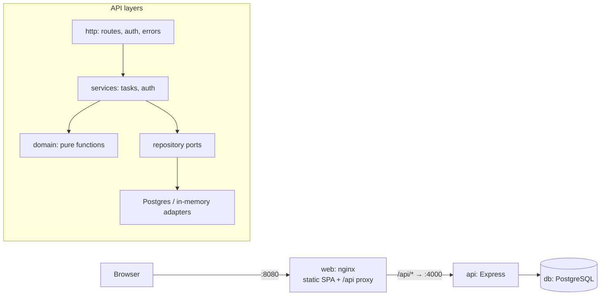
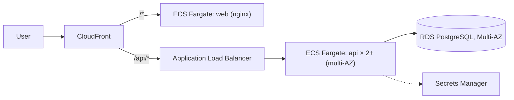

# To-Do List

A full-stack to-do list application: a REST API (Node, Express, PostgreSQL) and a responsive React web client. Users sign in and manage only their own tasks: create, read, update, delete, search, and reorder them by drag-and-drop or with up/down buttons.

Everything is TypeScript, built test-first in small layered checkpoints, and runs with one command.

## Quick start (macOS)

Prerequisite: [Docker Desktop](https://www.docker.com/products/docker-desktop/).

```sh
git clone https://github.com/zarkara/todo-app.git
cd todo-app
docker compose up --build
```

Open **http://localhost:8080** and sign in with one of the demo accounts:

| Email               | Password      |
| ------------------- | ------------- |
| `demo@example.com`  | `password123` |
| `grace@example.com` | `password123` |

Signing in as both, in two browsers, shows that each user sees only their own tasks.

Compose starts three containers: `db` (PostgreSQL 17, bound to `127.0.0.1:5432`), `api` (reachable only through nginx) and `web` (unprivileged nginx on port 8080, which serves the app and proxies `/api` to the API). Data persists in the `db-data` volume; `docker compose down -v` resets it. If a port is taken, override it, for example `WEB_PORT=8081 POSTGRES_PORT=5433 docker compose up --build`.

## Local development

Requires Node 22 (`nvm use` reads `.nvmrc`).

```sh
npm ci
cp .env.example .env
npm run db:up          # PostgreSQL in Docker
npm run dev            # API on :4000 with reload, web on http://localhost:5173
```

Vite proxies `/api` to the API, so the browser always talks to one origin in development and in production, and no CORS setup is needed.

| Command                          | What it does                                                                                                                                                                                 |
| -------------------------------- | -------------------------------------------------------------------------------------------------------------------------------------------------------------------------------------------- |
| `npm test`                       | Unit and component tests (needs nothing running)                                                                                                                                             |
| `npm run test:integration`       | Postgres integration tests in their own `todo_test` database, created automatically (`npm run db:up` first)                                                                                  |
| `npm run test:coverage`          | Everything, with a coverage report and 80% thresholds                                                                                                                                        |
| `npm run lint`                   | ESLint (bans `console` and TODO/FIXME comments) and Prettier                                                                                                                                 |
| `npm run typecheck`              | `tsc` in strict mode for every workspace                                                                                                                                                     |
| `npm run check`                  | lint, typecheck and unit tests: the gate used before each commit                                                                                                                             |
| `./scripts/validate-deploy.sh`   | Against a running stack: proves re-deploying is idempotent (no recreation, migrations and seeding no-ops, data kept)                                                                         |
| `./scripts/validate-security.sh` | Against a running stack: validates every security layer (edge headers, network exposure, non-root containers, production guard, authentication, authorization, error hygiene, rate limiting) |

CI (GitHub Actions) runs lint, typecheck and the full suite against a Postgres service container, then builds and starts the whole stack and runs both validation scripts against it, on every branch.

## Assignment summary

### Overall approach

1. **Analysis and plan first.** I turned the brief into numbered requirements, then planned the work as inside-out layers, each a checkpoint with its own tests and commit.
2. **Layered, dependencies pointing inward.** Pure domain functions sit in the middle. Around them are repositories (ports with in-memory and Postgres adapters), then services, then the HTTP layer, and then the web client's data layer and screens.
3. **Test-driven.** At each checkpoint I wrote the tests first and watched them fail. Then I wrote the simplest code that passed, refactored, ran the gate (`npm run check`), and committed. The git history follows that order, one checkpoint per commit.
4. **One contract.** `packages/shared` holds zod schemas that validate requests on the server, validate forms and responses in the browser, and provide the TypeScript types for both.
5. **Functional style.** Domain logic is pure and immutable (`map`, `filter`, `reduce`, curried predicates such as `matchesQuery(q)`). Composition happens in factories that receive their dependencies. Async work goes through higher-order functions (`asyncHandler`, `requireAuth`, `withTransaction`) and TanStack Query.

### Features completed

- [x] Sign-in page as the landing page. After signing in, users return to the page they originally requested.
- [x] Per-user data: another user's task looks exactly like a missing one (404).
- [x] Task list with search (debounced, kept in the URL so it survives reloads and can be shared).
- [x] Create, toggle done, edit on a detail screen, and delete (with confirmation).
- [x] Reordering with drag-and-drop (mouse, touch and keyboard) or ▲/▼ buttons. Changes show immediately and are rolled back if the server rejects them.
- [x] Responsive, accessible UI: mobile-first, 44px touch targets, labelled controls, dark mode.
- [x] REST API with standard status codes and one error format.
- [x] PostgreSQL storage with transactional reorder.
- [x] Docker images for the API and web, and Compose for the whole stack.
- [x] Hardening: bcrypt, HS256 JWT with the algorithm pinned, login rate limiting, helmet, a strict CSP from nginx, no internal details in 500 responses.
- [x] 213 automated tests (192 unit and component, 21 against real Postgres), about 98.6% line coverage, CI on every push to `main` and every pull request.

### Architecture



```
packages/shared   zod schemas and inferred types (the API contract)
apps/api          Express API: domain, repositories, services, http, server.ts (composition root)
apps/web          React client: api client, query hooks, auth, components, pages
```

### REST API

All `/tasks` routes require `Authorization: Bearer <token>`. Errors always have the shape `{ "error": { "code", "message", "details?" } }`.

| Method   | Path           | Body                                   | Success                        | Errors        |
| -------- | -------------- | -------------------------------------- | ------------------------------ | ------------- |
| `POST`   | `/auth/login`  | `{ email, password }`                  | 200 `{ token, user }`          | 400, 401, 429 |
| `GET`    | `/tasks?q=`    | —                                      | 200 `Task[]` in position order | 401           |
| `POST`   | `/tasks`       | `{ title, description? }`              | 201 `Task`, appended last      | 400, 401      |
| `GET`    | `/tasks/:id`   | —                                      | 200 `Task`                     | 401, 404      |
| `PATCH`  | `/tasks/:id`   | `{ title?, description?, completed? }` | 200 `Task`                     | 400, 401, 404 |
| `DELETE` | `/tasks/:id`   | —                                      | 204                            | 401, 404      |
| `PUT`    | `/tasks/order` | `{ ids: string[] }` (every task, once) | 200 `Task[]`                   | 400, 401      |
| `GET`    | `/health`      | —                                      | 200                            | —             |

```sh
TOKEN=$(curl -s localhost:8080/api/auth/login -H 'content-type: application/json' \
  -d '{"email":"demo@example.com","password":"password123"}' | sed -E 's/.*"token":"([^"]+)".*/\1/')
curl -s localhost:8080/api/tasks -H "authorization: Bearer $TOKEN"
```

### Given more time

| Item                                                                                                | Estimate |
| --------------------------------------------------------------------------------------------------- | -------- |
| Sign-up and password reset (email flow)                                                             | 4h       |
| httpOnly-cookie sessions with refresh-token rotation, instead of a bearer token in `sessionStorage` | 3h       |
| Versioned migrations (for example node-pg-migrate) run as a separate deploy step                    | 2h       |
| Due dates, priorities and filters (completed/active)                                                | 3h       |
| Browser end-to-end tests (Playwright) in CI; a local script already exercises the compose stack     | 2h       |
| Pagination or virtualised lists for very large task lists                                           | 2h       |
| Infrastructure as code (Terraform) for the AWS deployment below                                     | 6h       |

### Making it more robust

- **Concurrent creates:** two simultaneous creates by one user can get the same position. Sorting breaks ties by id, so nothing breaks, but a transaction with `SELECT … FOR UPDATE`, or fractional positions, would remove the tie (about 1h).
- **Observability:** structured logs (pino) with request ids, metrics for latency and error rate, and a readiness probe that checks the database (about 2h).
- **Rate limiting across instances:** move the login limiter's store to Redis so the limit holds across API replicas (about 1h).
- **Optimistic concurrency:** compare `updatedAt` (or an ETag) on PATCH so two tabs can't silently overwrite each other (about 2h).
- **Accessibility audit:** run axe in the component tests, and screen-reader testing of drag-and-drop announcements (about 2h).
- **Dependency hygiene:** Renovate or Dependabot, plus image scanning (Trivy) in CI (about 1h).

## Deploying to a distributed cloud (AWS)

The containers are stateless, and the only state lives in PostgreSQL, so the stack maps directly onto managed services:



1. **Images:** CI builds `apps/api/Dockerfile` and `apps/web/Dockerfile` and pushes them to ECR, authenticating with GitHub OIDC (no long-lived keys).
2. **Database:** RDS PostgreSQL, Multi-AZ, with automated backups. The API gets `DATABASE_URL` from Secrets Manager.
3. **API:** an ECS Fargate service with at least 2 tasks spread across availability zones, behind an ALB health-checking `/health`. Set `JWT_SECRET` (from Secrets Manager), `TRUST_PROXY_HOPS` to the number of proxies (CloudFront plus ALB), and leave `DEMO_USERS` empty in production.
4. **Web:** the same nginx image on ECS, or `vite build` output on S3. Either way it sits behind CloudFront, with an `/api/*` behaviour routed to the ALB so the browser stays on one origin.
5. **Migrations:** the schema step is idempotent and runs at start-up. With several replicas, run it once per deploy as a one-off ECS task before rolling the service.
6. **Rollout:** `aws ecs update-service --force-new-deployment` (rolling, health-checked). Roll back by redeploying the previous image tag.

On other clouds the mapping is the same: Cloud Run and Cloud SQL on GCP, or Container Apps and Azure Database for PostgreSQL on Azure.
