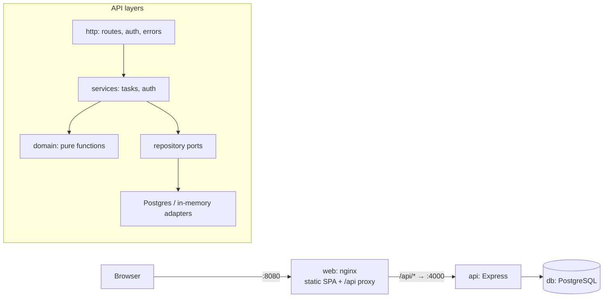
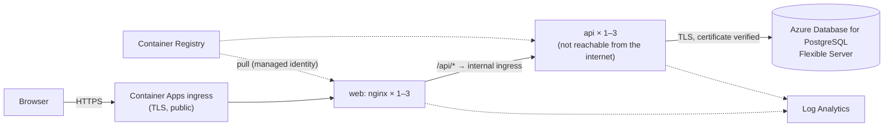

# To-Do List

A full-stack to-do list application: a REST API (Node, Express, PostgreSQL) and a responsive React web client. Users sign in and manage only their own tasks: create, read, update, delete, search, and reorder them by drag-and-drop or with up/down buttons.

Everything is TypeScript, built test-first in small layered checkpoints, and runs with one command.

## Quick start (macOS)

Prerequisite: [Docker Desktop](https://www.docker.com/products/docker-desktop/).

```sh
git clone https://github.com/zarkara/todo-app.git
cd todo-app
docker compose up --build
```

Open **http://localhost:8080** and sign in with one of the demo accounts:

| Email               | Password      |
| ------------------- | ------------- |
| `demo@example.com`  | `password123` |
| `grace@example.com` | `password123` |

Signing in as both, in two browsers, shows that each user sees only their own tasks.

**Using it:** the app opens on the sign-in page. After signing in you land on "Your tasks", which starts empty. Add tasks in the box at the top; tick one to mark it done; search from the search box (the search is kept in the URL); reorder by dragging the handle or with the ▲/▼ buttons; and click a task to open its detail screen, where you can edit the title, description and done state, or delete it. Your session lasts for the browser tab (eight hours at most); **Sign out** ends it.

**Accounts:** there is no sign-up screen. The API creates the accounts listed in `DEMO_USERS` (comma-separated `email:password` pairs) every time it starts, keeping existing accounts and their tasks. To add your own:

```sh
DEMO_USERS='me@example.com:a-long-password,demo@example.com:password123' docker compose up --build
```

Demo accounts are refused in production mode (`NODE_ENV=production`), so a production deployment has no way to create accounts yet; sign-up is listed under "Given more time".

### Smoke test: check the first-time user experience

With the stack running, this drives a real browser through what a new user does, and cleans up after itself:

```sh
npm ci
npx playwright install chromium   # once: the browser it drives
npm run smoke
```

Expect 18 passing steps, ending in `First-time user journey works`:

1. Opening the app shows the sign-in page; an empty form explains what's missing; a wrong password is refused with "Invalid email or password".
2. Signing in as `demo@example.com` opens "Your tasks", with the account in the header and, for a new account, an empty list with a hint.
3. Adding three tasks lists them in order; a blank title is refused; ticking a task keeps it done after a reload.
4. Search narrows the list, is kept in the URL and survives a reload; moving a task up saves the new order.
5. A task's detail screen saves edits; deleting asks for confirmation; signing out locks the list again.
6. On a phone-sized screen, `grace@example.com` follows a link to one of demo's tasks, signs in, lands on that link, and gets "Task not found"; her list shows none of demo's tasks, and the page fits the screen.
7. The browser console shows no unexpected errors.

A failure names the step and what it saw. If the app isn't running, it says how to start it. Set `SMOKE_URL` to test another address.

Compose starts three containers: `db` (PostgreSQL 17, not published, so a Postgres already running on your Mac doesn't conflict), `api` (reachable only through nginx) and `web` (unprivileged nginx on port 8080, which serves the app and proxies `/api` to the API). Data persists in the `db-data` volume; `docker compose down -v` resets it. If a port is taken, override it, for example `WEB_PORT=8081 docker compose up --build`.

## Local development

Requires Node 22 (`nvm use` reads `.nvmrc`).

```sh
npm ci
cp .env.example .env
npm run db:up          # PostgreSQL in Docker, published on 127.0.0.1:5432 (POSTGRES_PORT to change)
npm run dev            # API on :4000 with reload, web on http://localhost:5173
```

Vite proxies `/api` to the API, so the browser always talks to one origin in development and in production, and no CORS setup is needed.

| Command                          | What it does                                                                                                                                                                                 |
| -------------------------------- | -------------------------------------------------------------------------------------------------------------------------------------------------------------------------------------------- |
| `npm test`                       | Unit and component tests (needs nothing running)                                                                                                                                             |
| `npm run test:integration`       | Postgres integration tests in their own `todo_test` database, created automatically (`npm run db:up` first)                                                                                  |
| `npm run test:coverage`          | Everything, with a coverage report and 80% thresholds                                                                                                                                        |
| `npm run lint`                   | ESLint (bans `console` and TODO/FIXME comments) and Prettier                                                                                                                                 |
| `npm run typecheck`              | `tsc` in strict mode for every workspace                                                                                                                                                     |
| `npm run check`                  | lint, typecheck and unit tests: the gate used before each commit                                                                                                                             |
| `npm run smoke`                  | Against a running stack: the first-time user journey in a real browser (see Smoke test above)                                                                                                |
| `./scripts/validate-deploy.sh`   | Against a running stack: proves re-deploying is idempotent (no recreation, migrations and seeding no-ops, data kept)                                                                         |
| `./scripts/validate-security.sh` | Against a running stack: validates every security layer (edge headers, network exposure, non-root containers, production guard, authentication, authorization, error hygiene, rate limiting) |

CI (GitHub Actions) runs lint, typecheck and the full suite against a Postgres service container, then builds and starts the whole stack and runs both validation scripts against it, on every branch.

## Assignment summary

The challenge: build a full-stack to-do list with a minimal REST backend and a responsive web client. Users sign in on a landing page, then see, create, update, delete, reorder and search only their own tasks, and open any task on a detail screen to view or edit it. The deliverables are production-ready, tested code in a git repository, and this README with instructions for running it on a Mac.

### Overall approach

1. **Analysis and plan first.** I turned the brief into numbered requirements, then planned the work as inside-out layers, each a checkpoint with its own tests and commit.
2. **Layered, dependencies pointing inward.** Pure domain functions sit in the middle. Around them are repositories (ports with in-memory and Postgres adapters), then services, then the HTTP layer, and then the web client's data layer and screens.
3. **Test-driven.** At each checkpoint I wrote the tests first and watched them fail. Then I wrote the simplest code that passed, refactored, ran the gate (`npm run check`), and committed. The git history follows that order, one checkpoint per commit.
4. **One contract.** `packages/shared` holds zod schemas that validate requests on the server, validate forms and responses in the browser, and provide the TypeScript types for both.
5. **Functional style.** Domain logic is pure and immutable (`map`, `filter`, `reduce`, curried predicates such as `matchesQuery(q)`). Composition happens in factories that receive their dependencies. Async work goes through higher-order functions (`asyncHandler`, `requireAuth`, `withTransaction`) and TanStack Query.

### Features completed

- [x] Sign-in page as the landing page. After signing in, users return to the page they originally requested.
- [x] Per-user data: another user's task looks exactly like a missing one (404).
- [x] Task list with search (debounced, kept in the URL so it survives reloads and can be shared).
- [x] Create, toggle done, edit on a detail screen, and delete (with confirmation).
- [x] Reordering with drag-and-drop (mouse, touch and keyboard) or ▲/▼ buttons. Changes show immediately and are rolled back if the server rejects them.
- [x] Responsive, accessible UI: mobile-first, 44px touch targets, labelled controls, dark mode.
- [x] REST API with standard status codes and one error format.
- [x] PostgreSQL storage with transactional reorder.
- [x] Docker images for the API and web, and Compose for the whole stack.
- [x] Hardening: bcrypt, HS256 JWT with the algorithm pinned, login rate limiting, helmet, a strict CSP from nginx, no internal details in 500 responses.
- [x] 249 automated tests (221 unit and component, 28 against real Postgres), about 98.7% line coverage. CI runs them on every push and pull request, then starts the whole stack and runs the deploy and security validation scripts against it.

### Architecture



```
packages/shared   zod schemas and inferred types (the API contract)
apps/api          Express API: domain, repositories, services, http, server.ts (composition root)
apps/web          React client: api client, query hooks, auth, components, pages
```

### REST API

All `/tasks` routes require `Authorization: Bearer <token>`. Errors always have the shape `{ "error": { "code", "message", "details?" } }`.

| Method   | Path           | Body                                   | Success                        | Errors        |
| -------- | -------------- | -------------------------------------- | ------------------------------ | ------------- |
| `POST`   | `/auth/login`  | `{ email, password }`                  | 200 `{ token, user }`          | 400, 401, 429 |
| `GET`    | `/tasks?q=`    | —                                      | 200 `Task[]` in position order | 401           |
| `POST`   | `/tasks`       | `{ title, description? }`              | 201 `Task`, appended last      | 400, 401      |
| `GET`    | `/tasks/:id`   | —                                      | 200 `Task`                     | 401, 404      |
| `PATCH`  | `/tasks/:id`   | `{ title?, description?, completed? }` | 200 `Task`                     | 400, 401, 404 |
| `DELETE` | `/tasks/:id`   | —                                      | 204                            | 401, 404      |
| `PUT`    | `/tasks/order` | `{ ids: string[] }` (every task, once) | 200 `Task[]`                   | 400, 401      |
| `GET`    | `/health`      | —                                      | 200                            | —             |
| `GET`    | `/ready`       | —                                      | 200 when the database answers  | 503           |

```sh
TOKEN=$(curl -s localhost:8080/api/auth/login -H 'content-type: application/json' \
  -d '{"email":"demo@example.com","password":"password123"}' | sed -E 's/.*"token":"([^"]+)".*/\1/')
curl -s localhost:8080/api/tasks -H "authorization: Bearer $TOKEN"
```

### Given more time

| Item                                                                                                | Estimate |
| --------------------------------------------------------------------------------------------------- | -------- |
| Sign-up and password reset (email flow)                                                             | 4h       |
| httpOnly-cookie sessions with refresh-token rotation, instead of a bearer token in `sessionStorage` | 3h       |
| Due dates, priorities and filters (completed/active)                                                | 3h       |
| Browser end-to-end tests (Playwright) in CI; a local script already exercises the compose stack     | 2h       |
| Pagination or virtualised lists for very large task lists                                           | 2h       |

### Making it more robust

- **Concurrent creates:** two simultaneous creates by one user can get the same position. Sorting breaks ties by id, so nothing breaks, but a transaction with `SELECT … FOR UPDATE`, or fractional positions, would remove the tie (about 1h).
- **Observability:** structured logs (pino) with request ids, and metrics for latency and error rate (about 2h).
- **Rate limiting across instances:** move the login limiter's store to Redis so the limit holds across API replicas (about 1h).
- **Optimistic concurrency:** compare `updatedAt` (or an ETag) on PATCH so two tabs can't silently overwrite each other (about 2h).
- **Accessibility audit:** run axe in the component tests, and screen-reader testing of drag-and-drop announcements (about 2h).
- **Dependency hygiene:** Renovate or Dependabot, plus image scanning (Trivy) in CI (about 1h).

## Deploying to a distributed cloud (Azure)

`infra/azure/main.bicep` describes the whole deployment, and `infra/azure/azuredeploy.json` is the ARM template compiled from it. The containers are stateless and the only state lives in PostgreSQL, so the stack maps onto managed services:



Prerequisites: an Azure subscription and the Azure CLI (`brew install azure-cli`, then `az login`).

```sh
RG=todo-rg REGISTRY=todoacr$RANDOM TAG=1.0.0
az group create --name $RG --location eastus
az acr create --resource-group $RG --name $REGISTRY --sku Basic

# Built in Azure for linux/amd64, so an Apple Silicon Mac builds the right architecture.
az acr build --registry $REGISTRY --image todo-api:$TAG --file apps/api/Dockerfile .
az acr build --registry $REGISTRY --image todo-web:$TAG --file apps/web/Dockerfile .

# Generate the secrets once and keep them: re-deploying with new values rotates them.
umask 077; [ -f .azure-secrets ] || printf 'JWT_SECRET=%s\nPG_PASSWORD=%s\n' \
  "$(openssl rand -base64 48)" "$(openssl rand -base64 24)" > .azure-secrets
. ./.azure-secrets

az deployment group create --resource-group $RG --template-file infra/azure/azuredeploy.json \
  --parameters registryName=$REGISTRY apiImage=todo-api:$TAG webImage=todo-web:$TAG \
    jwtSecret="$JWT_SECRET" postgresAdminPassword="$PG_PASSWORD" \
  --query properties.outputs.url.value --output tsv
```

The last command prints the app's HTTPS URL. What the template sets up:

- **Web:** nginx on Container Apps behind the platform's HTTPS ingress (HTTP is redirected), scaling from 1 to 3 replicas. It proxies `/api/` to the API's internal address, so the browser stays on one origin.
- **API:** internal ingress only. Production mode with no demo users, `JWT_SECRET` and `DATABASE_URL` held as Container Apps secrets, database TLS with certificate verification (`DATABASE_SSL=verify-full`), and liveness (`/health`) and readiness (`/ready`) probes. Migrations run at start-up under a Postgres advisory lock, so several replicas starting together apply them once.
- **Database:** PostgreSQL Flexible Server (Burstable B1ms, 32 GB with auto-grow, 7-day point-in-time backups). Its firewall admits Azure services only, and it requires TLS.
- **Images and logs:** pulled from the registry by a managed identity with only the `AcrPull` role, so there are no registry passwords. Container logs go to Log Analytics.

**Releasing a new version:** build the images with a new `TAG` and run the deployment command again. Container Apps starts a new revision and moves traffic once it passes readiness. Roll back by deploying the previous tag. Re-running the deployment with the same values changes nothing.

**Verified so far:** the Bicep compiles and lints cleanly against the Azure resource schemas, and the nginx change it needs passes the full local validation. It hasn't been deployed to a live subscription yet. After the first deploy, confirm that eleven failed sign-ins return 429, and that a forged `X-Forwarded-For` header doesn't reset the limit; that checks `trustProxyHops`, which assumes three proxies in front of the API.

**For a larger deployment:** zone-redundant high availability on the database (`highAvailability: ZoneRedundant`, General Purpose tier); a virtual network with a private endpoint for PostgreSQL instead of the Azure-services firewall rule; Key Vault references for the secrets; and a CI workflow that builds, pushes and deploys with OpenID Connect.
